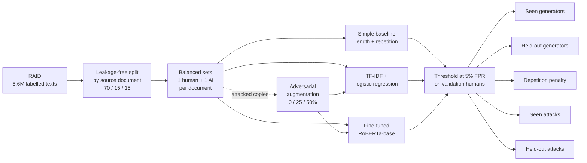
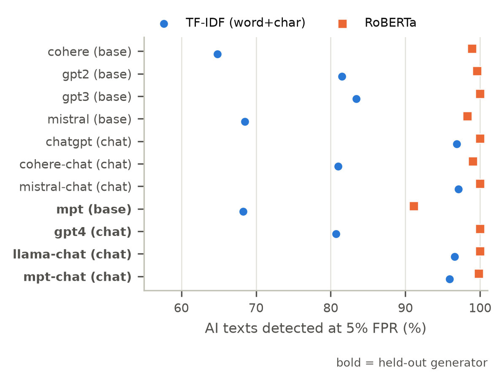
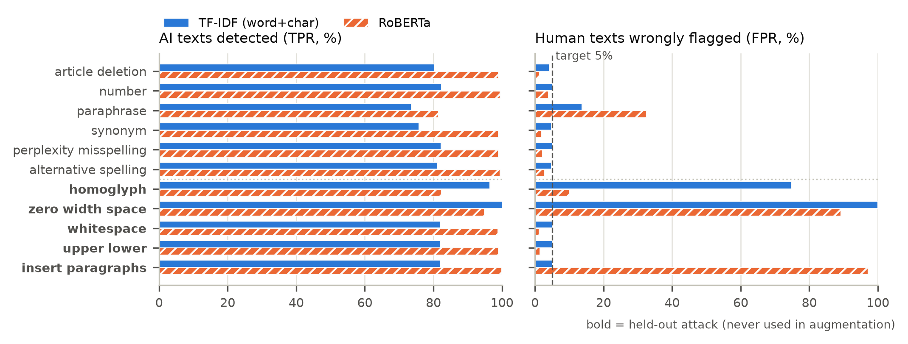
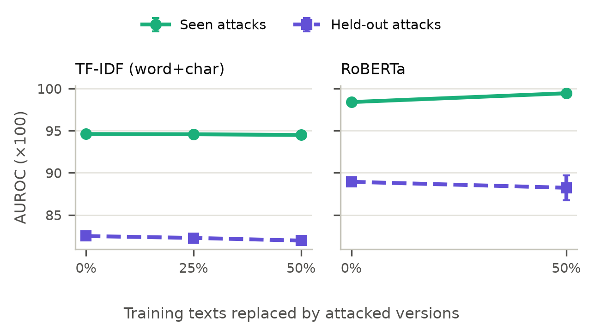
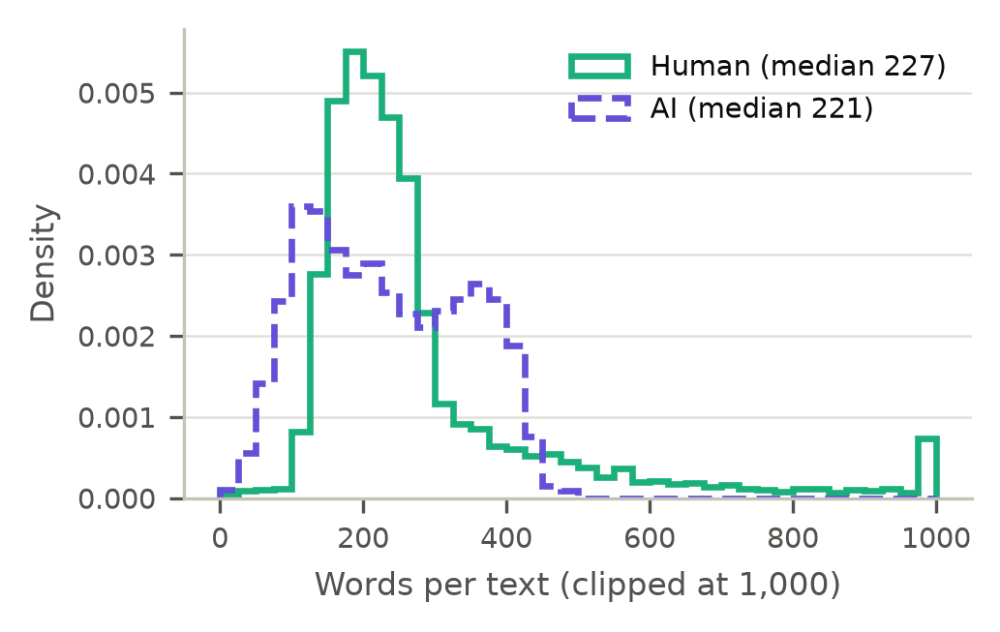

# Do AI-Text Detectors Generalise?

### Unseen generators, held-out attacks and adversarial augmentation on RAID


-4B8BBE)

MSc in Artificial Intelligence · National College of Ireland · Machine Learning project
**Author:** Sourav Arun Mahajan

---

## In one paragraph

AI-text detectors are used to flag machine-written essays, spam and misinformation,
but they are usually tested on the same kind of text they were trained on. The
[RAID benchmark](https://github.com/liamdugan/raid) showed that off-the-shelf
detectors break on unfamiliar AI models and simple tricks, but it never trained
detectors under **controlled** conditions. This project does: it trains three
detectors on RAID, hides some AI models and some attack types during training, and
measures what happens on the hidden ones. It also tests whether **training on
attacked text** (adversarial augmentation) makes detectors harder to fool.

> **Research question:** How much does the accuracy at a 5% false positive rate of
> TF-IDF and RoBERTa detectors drop when tested on unseen generators and held-out
> attacks in RAID, and does adversarial augmentation reduce this drop?

---

## Key findings

| | Finding |
|---|---|
| 🏆 | **RoBERTa is far stronger than TF-IDF**: it catches 99.5% of AI texts vs 82.1%, with only 5% of human texts wrongly flagged. |
| 🔍 | **Unseen generators cause a small but real drop for RoBERTa** (99.5% → 98.0%, about 4× more missed AI texts). Almost all of it comes from one **base** model, MPT (91%); the unseen **chat** models are caught almost perfectly. |
| ⚖️ | **Generator type matters as much as being unseen.** Base models are hard and chat models easy for both detectors, so averaging over a mixed set of generators can hide generalisation gaps. |
| 🛡️ | **Adversarial augmentation works only on attacks it has seen.** For RoBERTa it lifts paraphrase detection from 81.5% to 95.3%, but it does nothing for attacks it never trained on. |
| ⚠️ | **Each detector has its own blind spots.** Homoglyphs make TF-IDF flag 75% of human texts; inserted paragraph breaks make RoBERTa flag 97%; zero-width spaces break both. |
| 💻 | **RoBERTa's accuracy has a real cost**: ~18 min of GPU training and a 499 MB model, vs about a minute on a laptop CPU for TF-IDF. Fine-tuning RoBERTa did not fit in a 16 GB laptop's memory. |

---

## How it works



**Seen vs held-out:**

| | Used in training | Hidden until testing |
|---|---|---|
| **AI generators** | GPT-2, GPT-3, ChatGPT, Cohere, Cohere-Chat, Mistral, Mistral-Chat | **GPT-4, LLaMA-2-Chat, MPT, MPT-Chat** |
| **Attacks** | article deletion, number swap, paraphrase, synonym, misspelling, alternative spelling | **homoglyph, zero-width space, whitespace, upper/lower case, insert paragraphs** |

**The main metric** is the share of AI texts detected (TPR) when the threshold is set
so that only **5% of human texts are wrongly flagged**, following RAID. Wrongly
accusing a person of using AI is the costly mistake, so it is the one we control.

---

## Results

### Main comparison (% of AI texts detected at 5% FPR, mean over 3 seeds)

| Detector | Seen generators | Held-out generators | Repetition penalty | Seen attacks |
|---|---:|---:|---:|---:|
| Simple baseline | 33.3 | 22.1 | 2.3 | 33.6 |
| TF-IDF (word) | 78.5 | 83.6 | 43.9 | 75.3 |
| TF-IDF (word+char) | 82.1 | 85.1 | 49.6 | 79.2 |
| **RoBERTa** | **99.5** | **98.0** | **90.5** | **96.2** |

Held-out attacks are not in this table on purpose: some of them make detectors flag
almost **every** text as AI, so a high detection rate there is meaningless without
the false-positive rate. See the attack figure below.

### Which unseen AI models are hard?



RoBERTa catches the unseen chat models (GPT-4, LLaMA-Chat, MPT-Chat) almost
perfectly; its drop comes from the unseen **base** model MPT. TF-IDF struggles with
base models whether it has seen them or not.

### What do attacks do?



The right panel is the important one: it shows how many **human** texts get wrongly
flagged after the same attack is applied to them. Anything far past the dashed 5%
line means the detector is not really detecting AI any more; it is reacting to the
strange characters or formatting.

### Does training on attacked text help?



Augmentation improves RoBERTa on the attack types it trained on (mostly paraphrase),
but the held-out attacks stay just as hard. The robustness does **not** transfer.

### Data at a glance



All tables behind these figures are in [`results/tables/`](results/tables/) as CSV
and LaTeX.

---

## Quick start

### 1. Environment

```bash
conda create -n raid python=3.11 -y
conda activate raid
pip install -r requirements.txt
pip install matplotlib jupyter          # for the analysis notebooks
```

`pyarrow<19` is required because the environment uses NumPy 1.x.

### 2. Data

The data is **not** stored in this repository. Download the labelled RAID training file:

```bash
mkdir -p data
curl -o data/train.csv https://dataset.raid-bench.xyz/train.csv
```

### 3. Reproduce everything

| Step | Command | Where | Time |
|---|---|---|---|
| Inspect the data (optional) | `python src/inspect_raid.py data/train.csv` | laptop | ~5 min |
| Build the splits | `python src/make_splits.py --raid data/train.csv --out data/processed --seed 42` | laptop | ~2 min |
| Baseline + TF-IDF | `python src/train_classical.py` | laptop CPU | ~10 min |
| RoBERTa: tune learning rate | `python src/train_roberta.py --seeds 42 --aug 0 --lrs 1e-5 2e-5 3e-5` | GPU (Kaggle T4) | ~1.3 h |
| RoBERTa: main runs | `python src/train_roberta.py --lrs 2e-5` | GPU (Kaggle T4) | ~2.5 h |
| Figures and tables | run `notebooks/01_eda.ipynb` → `02_results.ipynb` → `03_error_analysis.ipynb` | laptop | ~2 min |

RoBERTa runs save after every run and skip finished runs, so an interrupted session
can simply be restarted. A quick check before the long run:
`python src/train_roberta.py --limit 500 --seeds 42 --aug 0 --epochs 1 --out results/smoke`

---

## Design choices that keep the results honest

- **No leakage:** every human text and all AI or attacked versions of it share a
  `source_id` and always land in the same split. Notebook 01 checks this explicitly.
- **Balanced classes:** exactly one human and one AI text per source document.
- **No tuning on test data:** logistic-regression C, the RoBERTa learning rate, the
  best epoch and the 5% FPR threshold are all chosen on the validation set.
- **Seeds:** splits use seed 42; every model is trained with seeds 42, 43 and 44.
- **Fair augmentation:** attacked versions of *human* texts are included too, so a
  model cannot learn the shortcut "strange characters = AI".

## Hyperparameters

| Model | Settings |
|---|---|
| Simple baseline | log word count + repeated-word ratio → standardised → logistic regression |
| TF-IDF | word 1–2-grams (+ character 3–5-grams); max 200k features each; sublinear TF; logistic regression, C ∈ {0.1, 1, 10} |
| RoBERTa-base | max 512 tokens; AdamW (weight decay 0.01); lr ∈ {1e-5, 2e-5, 3e-5} (2e-5 chosen); batch 16 (8 × 2 accumulation); 6% warm-up; up to 2 epochs, best by validation AUROC; fp16 on GPU |

---

## Limitations

- **English only**, and the generators date from 2023; newer models are not covered.
- **Only one held-out base model** (MPT), so the base-model gap could partly be
  specific to MPT.
- RAID's **paraphrase** attack rewrites human texts with an AI paraphraser, so some
  "human" texts are partly machine-written. The label itself is debatable there.
- About **10% of texts** (and up to 47% of texts with character attacks) are cut at
  RoBERTa's 512-token limit.
- TF-IDF ran on a laptop CPU and RoBERTa on a cloud GPU, so training times are not
  measured on the same hardware.
- Detectors like these should **not** be used as sole evidence of misconduct:
  false positives fall on real people.

---

## Repository structure

```
├── src/
│   ├── inspect_raid.py       # dataset completeness check
│   ├── make_splits.py        # leakage-free, balanced experiment sets
│   ├── metrics.py            # TPR at 5% FPR, AUROC, macro-F1
│   ├── train_classical.py    # simple baseline + TF-IDF experiments
│   ├── train_roberta.py      # RoBERTa experiments (GPU)
│   └── report_utils.py       # shared helpers for the notebooks
├── notebooks/
│   ├── 01_eda.ipynb          # data exploration + leakage check
│   ├── 02_results.ipynb      # result tables and figures
│   └── 03_error_analysis.ipynb
├── results/
│   ├── *_results.csv         # every metric, every run
│   ├── *_efficiency.csv      # training time, speed, model size
│   ├── predictions/          # per-text scores for error analysis
│   ├── figures/              # report figures (PDF + PNG)
│   └── tables/               # report tables (CSV + LaTeX)
└── data/                     # not tracked; see "Data" above
```

---

## References

- L. Dugan *et al.*, "RAID: A shared benchmark for robust evaluation of machine-generated
  text detectors," *ACL 2024*. [Paper](https://aclanthology.org/2024.acl-long.674) ·
  [Data and code](https://github.com/liamdugan/raid)
- Y. Liu *et al.*, "RoBERTa: A robustly optimized BERT pretraining approach,"
  arXiv:1907.11692, 2019.

## AI usage

Code in this repository was produced with the help of Claude (Anthropic), as declared
on the project's AI acknowledgement cover sheet.
