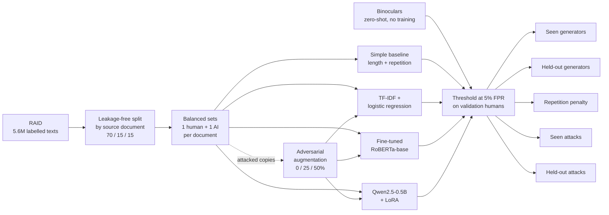
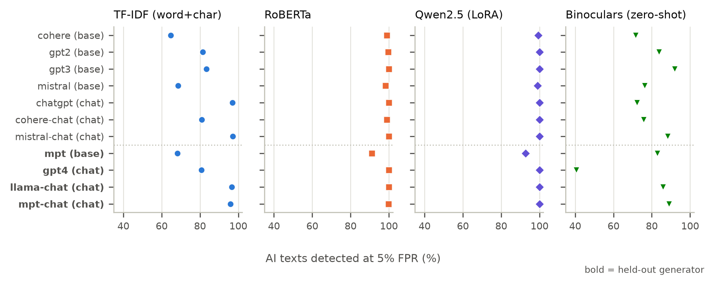
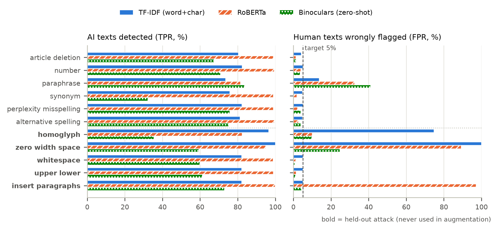
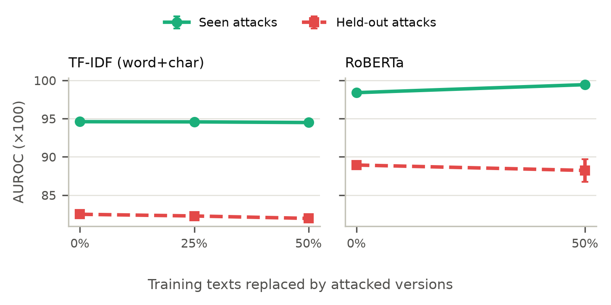
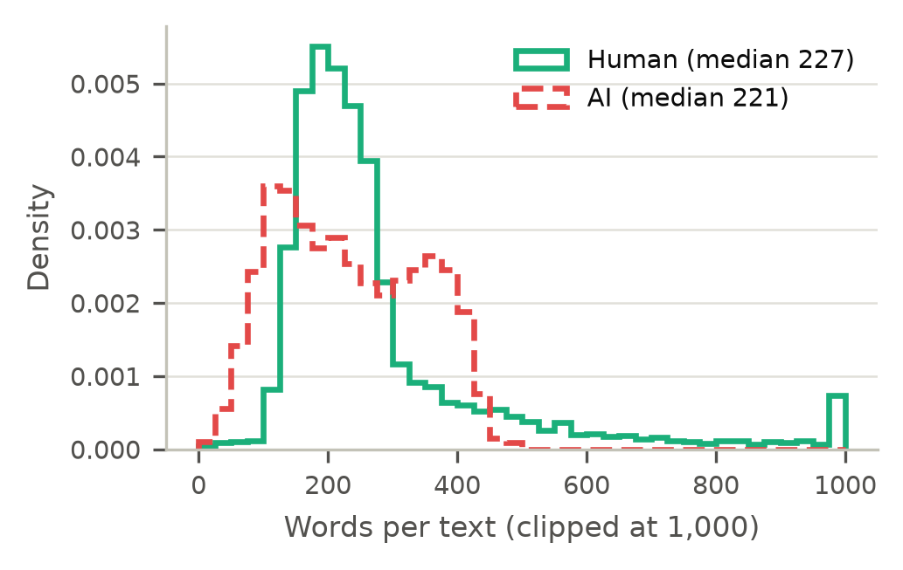
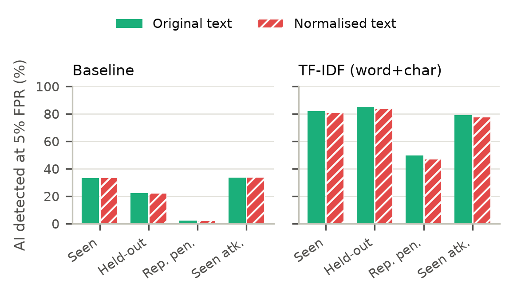
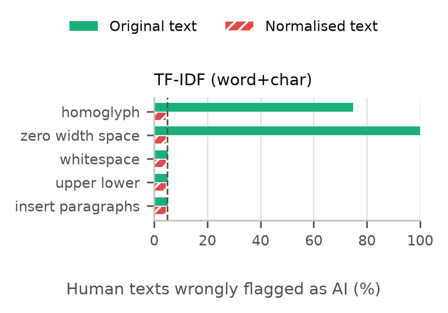

# Do AI-Text Detectors Generalise?

### Unseen generators, held-out attacks and adversarial augmentation on RAID


-4B8BBE)

MSc in Artificial Intelligence · National College of Ireland · Machine Learning project
**Author:** Sourav Arun Mahajan

---

## In one paragraph

AI-text detectors are used to flag machine-written essays, spam and misinformation,
but they are usually tested on the same kind of text they were trained on. The
[RAID benchmark](https://github.com/liamdugan/raid) showed that off-the-shelf
detectors break on unfamiliar AI models and simple tricks, but it never trained
detectors under **controlled** conditions. This project does: it trains several
detectors on RAID, hides some AI models and some attack types during training, and
measures what happens on the hidden ones. It also tests whether **training on
attacked text** (adversarial augmentation) makes detectors harder to fool,
compares the trained detectors with a **fine-tuned LLM** and a **zero-shot LLM
detector** that never sees any training data, and checks whether very high scores
come from real writing style or from **shortcuts** such as formatting.

All approaches here work **without watermarks**: they judge the finished text only,
either by learning patterns from labelled examples (TF-IDF, RoBERTa, Qwen) or by
measuring how predictable the text is to an LLM (Binoculars).

> **Research question:** How much does the accuracy at a 5% false positive rate of
> TF-IDF and RoBERTa detectors drop when tested on unseen generators and held-out
> attacks in RAID, and does adversarial augmentation reduce this drop?

---

## Key findings

| | Finding |
|---|---|
| 🏆 | **RoBERTa is far stronger than TF-IDF**: it catches 99.5% of AI texts vs 82.1%, with only 5% of human texts wrongly flagged. |
| 🔍 | **Unseen generators cause a small but real drop for RoBERTa** (99.5% → 98.0%, about 4× more missed AI texts). Almost all of it comes from one **base** model, MPT (91%); the unseen **chat** models are caught almost perfectly. |
| ⚖️ | **Generator type matters as much as being unseen.** Base models are hard and chat models easy for both detectors, so averaging over a mixed set of generators can hide generalisation gaps. |
| 🛡️ | **Adversarial augmentation works only on attacks it has seen.** For RoBERTa it lifts paraphrase detection from 81.5% to 95.3%, but it does nothing for attacks it never trained on. |
| ⚠️ | **Each detector has its own blind spots.** Homoglyphs make TF-IDF flag 75% of human texts; inserted paragraph breaks make RoBERTa flag 97%; zero-width spaces break both. |
| 🔭 | **A zero-shot LLM detector (Binoculars) catches 79.9% of AI texts with no training at all**, close to TF-IDF (82.1%) but far below RoBERTa. |
| 🔀 | **Trained and zero-shot detectors fail in opposite ways.** Trained detectors learn dataset shortcuts (inserted blank lines make RoBERTa flag 97% of human texts; Binoculars only 4%). Binoculars instead fails when text is made *less predictable*: repetition penalty (42.9%), synonym swaps (32.2%), homoglyphs (35.5%). |
| 🧩 | **Part of the very high scores rests on dataset shortcuts.** No human training text contains a blank line, but 70–100% of AI texts do; markdown (`##`, `1.`) points to AI, and scraping leftovers (`<br />`, broken `�` characters) point to human. |
| 🧹 | **Removing these clues barely changes TF-IDF** (82.1% → 80.9%), so it mostly uses real wording, and it **fully neutralises the held-out attacks** for TF-IDF at no training cost, unlike augmentation. The same check for RoBERTa is in progress. |
| 🧠 | **A larger LLM (Qwen2.5-0.5B + LoRA) is only slightly more accurate than RoBERTa** (99.8% vs 99.5% seen, 98.5% vs 98.0% held-out) at about 3.6× the training time and 5× slower prediction, and it is **even more fooled by look-alike letters** (73% of human texts flagged vs 10% for RoBERTa). Model size does not fix the shortcuts. |
| 🔁 | **Augmentation behaves the same for Qwen as for RoBERTa:** it helps on the attacks it trained on (paraphrase AUROC 0.80 → 0.94) but not on held-out attacks (AUROC 0.86 → 0.88; homoglyph, zero-width and paragraph attacks still flag most human texts). |
| 🧪 | **In progress:** RoBERTa retrained on cleaned text. |
| 💻 | **RoBERTa's accuracy has a real cost**: ~18 min of GPU training and a 499 MB model, vs about a minute on a laptop CPU for TF-IDF. Fine-tuning RoBERTa did not fit in a 16 GB laptop's memory. |

---

## How it works



**Seen vs held-out:**

| | Used in training | Hidden until testing |
|---|---|---|
| **AI generators** | GPT-2, GPT-3, ChatGPT, Cohere, Cohere-Chat, Mistral, Mistral-Chat | **GPT-4, LLaMA-2-Chat, MPT, MPT-Chat** |
| **Attacks** | article deletion, number swap, paraphrase, synonym, misspelling, alternative spelling | **homoglyph, zero-width space, whitespace, upper/lower case, insert paragraphs** |

**The main metric** is the share of AI texts detected (TPR) when the threshold is set
so that only **5% of human texts are wrongly flagged**, following RAID. Wrongly
accusing a person of using AI is the costly mistake, so it is the one we control.

---

## Results

### Main comparison (% of AI texts detected at 5% FPR, mean over 3 seeds)

| Detector | Seen generators | Held-out generators | Repetition penalty | Seen attacks |
|---|---:|---:|---:|---:|
| Simple baseline | 33.3 | 22.1 | 2.3 | 33.6 |
| TF-IDF (word) | 78.5 | 83.6 | 43.9 | 75.3 |
| TF-IDF (word+char) | 82.1 | 85.1 | 49.6 | 79.2 |
| **RoBERTa** | **99.5** | **98.0** | **90.5** | **96.2** |
| Binoculars (zero-shot, no training) | 79.9 | 74.0 | 42.9 | 67.5 |
| Qwen2.5-0.5B + LoRA | 99.8 | 98.5 | 92.0 | 97.5 |

Held-out attacks are not in this table on purpose: some of them make detectors flag
almost **every** text as AI, so a high detection rate there is meaningless without
the false-positive rate. See the attack figure below. Binoculars has one run only:
it has no training, so it has no seed to vary.

### Which unseen AI models are hard?



RoBERTa catches the unseen chat models (GPT-4, LLaMA-Chat, MPT-Chat) almost
perfectly; its drop comes from the unseen **base** model MPT. TF-IDF struggles with
base models whether it has seen them or not.

### What do attacks do?



The right panel is the important one: it shows how many **human** texts get wrongly
flagged after the same attack is applied to them. Anything far past the dashed 5%
line means the detector is not really detecting AI any more; it is reacting to the
strange characters or formatting.

### Does training on attacked text help?



Augmentation improves RoBERTa on the attack types it trained on (mostly paraphrase),
but the held-out attacks stay just as hard. The robustness does **not** transfer.

### Data at a glance



All tables behind these figures are in [`results/tables/`](results/tables/) as CSV
and LaTeX.

---

## Quick start

### 1. Environment

```bash
conda create -n raid python=3.11 -y
conda activate raid
pip install -r requirements.txt
pip install matplotlib jupyter          # for the analysis notebooks
```

`pyarrow<19` is required because the environment uses NumPy 1.x.

### 2. Data

The data is **not** stored in this repository. Download the labelled RAID training file:

```bash
mkdir -p data
curl -o data/train.csv https://dataset.raid-bench.xyz/train.csv
```

### 3. Reproduce everything

| Step | Command | Where | Time |
|---|---|---|---|
| Inspect the data (optional) | `python src/inspect_raid.py data/train.csv` | laptop | ~5 min |
| Build the splits | `python src/make_splits.py --raid data/train.csv --out data/processed --seed 42` | laptop | ~2 min |
| Baseline + TF-IDF | `python src/train_classical.py` | laptop CPU | ~10 min |
| RoBERTa: tune learning rate | `python src/train_roberta.py --seeds 42 --aug 0 --lrs 1e-5 2e-5 3e-5` | GPU (Kaggle T4) | ~1.3 h |
| RoBERTa: main runs | `python src/train_roberta.py --lrs 2e-5` | GPU (Kaggle T4) | ~2.5 h |
| Zero-shot Binoculars | `python src/zero_shot_binoculars.py` | 2× GPU (Kaggle T4 x2) | ~2 h |
| LLM: tune learning rate | `python src/train_llm.py --seeds 42 --aug 0 --lrs 5e-5 1e-4 2e-4 --tune-only --out results/tuning` | GPU (Kaggle T4) | ~3 h |
| LLM: main runs | `python src/train_llm.py --lrs 1e-4 --aug 0` then `--aug 0.5` | GPU (Kaggle T4) | ~5.5 h each |
| Shortcut check: clean text | `python src/normalize_text.py` | laptop | ~1 min |
| Shortcut check: TF-IDF clues | `python src/shortcut_features.py` | laptop | ~2 min |
| Shortcut check: TF-IDF on clean text | `python src/train_classical.py --data data/processed_norm --out results/normalized --aug 0` | laptop | ~5 min |
| Shortcut check: RoBERTa on clean text | `python src/train_roberta.py --data data/processed_norm --aug 0 --lrs 2e-5 --out results/normalized` | GPU (Kaggle T4) | ~1.5 h |
| Figures and tables | run `notebooks/01_eda.ipynb` → `02_results.ipynb` → `03_error_analysis.ipynb` → `04_shortcuts.ipynb` | laptop | ~3 min |

The GPU steps were run with the Kaggle notebooks in [`kaggle/`](kaggle/), saved
with their logs: `kaggle_roberta.ipynb`, `kaggle_llm_session1.ipynb`,
`kaggle_llm_session2a.ipynb` (`AUG = "0"`), `kaggle_llm_session2b.ipynb` (`AUG = "0.5"`) and
`kaggle_normalized_roberta.ipynb`. To rerun one, upload `data/processed/*.parquet`
and `src/*.py` as a private Kaggle dataset, import the notebook, add the dataset as
input, and enable a GPU and internet access. The LLM scripts need
`pip install peft`; on Kaggle, uninstall the preinstalled `torchao` first. RoBERTa and LLM runs save after every run and skip finished runs, so an interrupted session
can simply be restarted. A quick check before the long run:
`python src/train_roberta.py --limit 500 --seeds 42 --aug 0 --epochs 1 --out results/smoke`

---

## Is 99.5% too good to be true? The shortcut check

Very high detection scores can come from **shortcuts**: surface clues such as layout,
line breaks or unusual characters, rather than writing style. Two checks test this:

1. **What does the model rely on?** The strongest TF-IDF clues and the formatting
   differences between human and AI text (`shortcut_features.py`).
2. **Remove the clues and retrain.** Every text is normalised (no line breaks or blank
   lines, no invisible or broken characters, look-alike letters mapped back, no HTML
   leftovers or markdown markers) and the detectors are trained and tested again. A big
   drop means part of the original score was a shortcut. On the attacked sets the same
   cleaning also acts as a simple, training-free defence.

**What the training data shows:**

| Clue | Human texts | AI texts | Kind of clue |
|---|---:|---:|---|
| Contains a blank line | **0%** | 70–100% | formatting shortcut |
| Contains list lines (`-`, `1.`) | 1.2% | 2–15% | formatting shortcut |
| Contains non-ASCII characters | 30.2% | 12–20% | mostly scraping leftovers |

Strongest TF-IDF clues: towards **AI**, markdown (`##`, `1.`, ` > `) and prompt words
(*ingredients*, *instructions*, *the paper*, *the film*); towards **human**, HTML leftovers
(`br`), broken characters (`�`), `...`, and common function words (*in, and, at, of, to*),
the last of which are genuine style differences.

**After cleaning (TF-IDF word+char, TPR at 5% FPR):** seen 82.1 → 80.9, held-out
generators 85.1 → 84.0, repetition penalty 49.6 → 47.1. Held-out attacks: 80.9, now
exactly equal to clean text, because cleaning undoes those attacks completely.





## Design choices that keep the results honest

- **No leakage:** every human text and all AI or attacked versions of it share a
  `source_id` and always land in the same split. Notebook 01 checks this explicitly.
- **Balanced classes:** exactly one human and one AI text per source document.
- **No tuning on test data:** logistic-regression C, the RoBERTa learning rate, the
  best epoch and the 5% FPR threshold are all chosen on the validation set.
- **Seeds:** splits use seed 42; every model is trained with seeds 42, 43 and 44.
- **Fair augmentation:** attacked versions of *human* texts are included too, so a
  model cannot learn the shortcut "strange characters = AI".

## Hyperparameters

| Model | Settings |
|---|---|
| Simple baseline | log word count + repeated-word ratio → standardised → logistic regression |
| TF-IDF | word 1–2-grams (+ character 3–5-grams); max 200k features each; sublinear TF; logistic regression, C ∈ {0.1, 1, 10} |
| RoBERTa-base | max 512 tokens; AdamW (weight decay 0.01); lr ∈ {1e-5, 2e-5, 3e-5} (2e-5 chosen); batch 16 (8 × 2 accumulation); 6% warm-up; up to 2 epochs, best by validation AUROC; fp16 on GPU |
| Qwen2.5-0.5B + LoRA | classification head on the last token; LoRA r = 16, α = 32, dropout 0.05 on all attention and MLP projections (~2% of weights trained); AdamW; lr ∈ {5e-5, 1e-4, 2e-4} tuned on validation only; otherwise as RoBERTa |
| Binoculars (zero-shot) | observer Qwen2.5-1.5B, performer Qwen2.5-1.5B-Instruct (the paper uses Falcon-7B); score = log-perplexity / cross-perplexity; no training; threshold at 5% validation FPR like the other detectors |

---

## Limitations

- **English only**, and the generators date from 2023; newer models are not covered.
- **Only one held-out base model** (MPT), so the base-model gap could partly be
  specific to MPT.
- RAID's **paraphrase** attack rewrites human texts with an AI paraphraser, so some
  "human" texts are partly machine-written. The label itself is debatable there.
- Binoculars uses a smaller **Qwen2.5-1.5B** model pair to fit a free GPU; the original
  paper uses Falcon-7B, so a larger pair may score higher.
- Text cleaning removes markdown and lists, which are partly genuine AI style, so the
  cleaned results are a **lower bound** on what style alone can achieve.
- About **10% of texts** (and up to 47% of texts with character attacks) are cut at
  RoBERTa's 512-token limit.
- TF-IDF ran on a laptop CPU and RoBERTa on a cloud GPU, so training times are not
  measured on the same hardware.
- Detectors like these should **not** be used as sole evidence of misconduct:
  false positives fall on real people.

---

## Repository structure

```
├── src/
│   ├── inspect_raid.py       # dataset completeness check
│   ├── make_splits.py        # leakage-free, balanced experiment sets
│   ├── metrics.py            # TPR at 5% FPR, AUROC, macro-F1
│   ├── train_classical.py    # simple baseline + TF-IDF experiments
│   ├── train_roberta.py      # RoBERTa experiments (GPU)
│   ├── train_llm.py          # LoRA fine-tuned LLM experiments (GPU)
│   ├── zero_shot_binoculars.py  # zero-shot LLM detector (GPU)
│   ├── normalize_text.py     # removes layout / invisible / look-alike characters
│   ├── shortcut_features.py  # TF-IDF top clues + formatting statistics
│   └── report_utils.py       # shared helpers for the notebooks
├── kaggle/                   # GPU notebooks as run on Kaggle (with logs)
│   ├── kaggle_roberta.ipynb
│   ├── kaggle_llm_session1.ipynb  # Binoculars + Qwen learning-rate tuning
│   ├── kaggle_llm_session2a.ipynb # Qwen main runs, no augmentation
│   ├── kaggle_llm_session2b.ipynb # Qwen main runs, 50% augmentation
│   └── kaggle_normalized_roberta.ipynb
├── notebooks/
│   ├── 01_eda.ipynb          # data exploration + leakage check
│   ├── 02_results.ipynb      # result tables and figures
│   ├── 03_error_analysis.ipynb
│   └── 04_shortcuts.ipynb    # original vs normalised text
├── results/
│   ├── *_results.csv         # every metric, every run
│   ├── *_efficiency.csv      # training time, speed, model size
│   ├── predictions/          # per-text scores for error analysis
│   ├── figures/              # report figures (PDF + PNG)
│   └── tables/               # report tables (CSV + LaTeX)
└── data/                     # not tracked; see "Data" above
```

---

## References

- L. Dugan *et al.*, "RAID: A shared benchmark for robust evaluation of machine-generated
  text detectors," *ACL 2024*. [Paper](https://aclanthology.org/2024.acl-long.674) ·
  [Data and code](https://github.com/liamdugan/raid)
- Y. Liu *et al.*, "RoBERTa: A robustly optimized BERT pretraining approach,"
  arXiv:1907.11692, 2019.
- E. J. Hu *et al.*, "LoRA: Low-rank adaptation of large language models," *ICLR 2022*.
- A. Hans *et al.*, "Spotting LLMs with Binoculars: Zero-shot detection of
  machine-generated text," *ICML 2024*.
- Qwen Team, "Qwen2.5 technical report," arXiv:2412.15115, 2024.
- J. Kirchenbauer *et al.*, "A watermark for large language models," *ICML 2023*
  (the watermark-based alternative, discussed but not used here).

## AI usage

Code in this repository was produced with the help of Claude (Anthropic), as declared
on the project's AI acknowledgement cover sheet.
